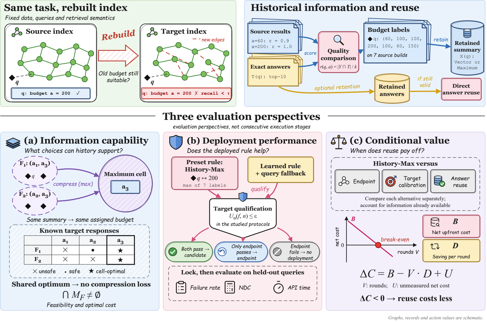

# When Is Cross-Index Search Budget Reuse Worthwhile?

An experimental and analytical study of search-budget reuse across ANN indexes.

**Lekang Wang, Pinze Ren, Zhen Chen** · Tsinghua University

[Paper PDF](https://github.com/edwards365/when-is-cross-index-search-budget-reuse-worthwhile/releases/download/submission-final-20261109/When_Is_Cross_Index_Search_Budget_Reuse_Worthwhile.pdf) · [Overleaf source](https://github.com/edwards365/when-is-cross-index-search-budget-reuse-worthwhile/releases/download/submission-final-20261109/When_Is_Cross_Index_Search_Budget_Reuse_Worthwhile_Overleaf.zip) · [Final submission materials](https://github.com/edwards365/when-is-cross-index-search-budget-reuse-worthwhile/releases/tag/submission-final-20261109) · [中文](README.zh-CN.md)

## Research

We study which budget choices historical information supports after an ANN index is rebuilt, how learned and qualified policies perform, and whether search savings offset information acquisition costs. The paper combines finite-budget analysis with 100K and million-vector experiments, deployment comparisons, and conditional cost accounting.

## Reproduce the results

Start with the [manuscript-to-evidence map](docs/manuscript/EVIDENCE.md), [supplementary protocol](https://github.com/edwards365/when-is-cross-index-search-budget-reuse-worthwhile/releases/download/submission-final-20261109/study_design_protocol.md), and [reproduction guide](https://github.com/edwards365/when-is-cross-index-search-budget-reuse-worthwhile/releases/download/submission-final-20261109/REPRODUCIBILITY.md).

| Material | Entry |
|---|---|
| Saved results and analysis commands | [Artifact runbook](artifact/README.md) |
| Transfer, deployment and cost statistics | [Paper reconstruction](artifact/paper/README.md) |
| Summary-cost reconstruction | [Saved-response runbook](artifact/RUNBOOK.md) |
| Mechanism, construction and learning evidence | [P0–P11 evidence](artifact/deepening/EVIDENCE.md) |
| Million-scale boundary-tie supplement | [P12 evidence](artifact/p12/EVIDENCE.md) |
| Original-protocol execution instructions | [Execution map](artifact/original_execution/EXECUTION_MAP.md) |

Use the fixed evidence tags linked in the reproduction guide for scientific reconstruction. Saved-record reconstruction and original search execution have distinct input and verification requirements, described in their runbooks. The source package supplies five figure PDFs; current editable figure sources are outside its scope.

## Citation and license

Repository metadata is available in [CITATION.cff](CITATION.cff). Code and project-generated materials use the [MIT license](LICENSE); third-party assets retain their own licenses. Dataset acquisition instructions are in the artifact runbooks. Historical releases remain available through [Releases](https://github.com/edwards365/when-is-cross-index-search-budget-reuse-worthwhile/releases).
