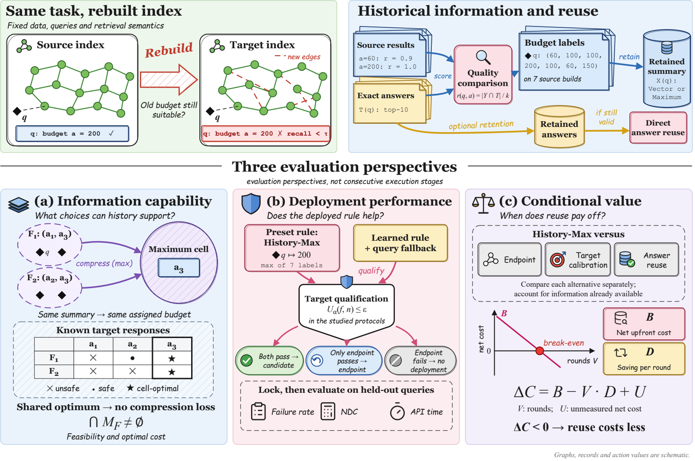

# When Is Cross-Index Search Budget Reuse Worthwhile?

研究 ANN 索引变化后的搜索预算可迁移性，以及预算复用的质量与成本价值。

**Lekang Wang、Pinze Ren、Zhen Chen** · 清华大学

[论文 PDF](https://github.com/edwards365/when-is-cross-index-search-budget-reuse-worthwhile/releases/download/submission-final-20261110-ai/When_Is_Cross_Index_Search_Budget_Reuse_Worthwhile.pdf) · [Overleaf 代码包](https://github.com/edwards365/when-is-cross-index-search-budget-reuse-worthwhile/releases/download/submission-final-20261110-ai/When_Is_Cross_Index_Search_Budget_Reuse_Worthwhile_Overleaf.zip) · [最终投稿材料](https://github.com/edwards365/when-is-cross-index-search-budget-reuse-worthwhile/releases/tag/submission-final-20261110-ai) · [English](README.md)

本研究结合有限预算分析、十万级和百万级实验、部署比较与成本核算，考察历史信息支持哪些预算选择、实际策略能取得怎样的质量与开销，以及搜索节省何时能抵消信息获取投入。

复现从[统一证据入口](docs/manuscript/EVIDENCE.md)、[配套协议](https://github.com/edwards365/when-is-cross-index-search-budget-reuse-worthwhile/releases/download/submission-final-20261110-ai/study_design_protocol.md)和[复现说明](https://github.com/edwards365/when-is-cross-index-search-budget-reuse-worthwhile/releases/download/submission-final-20261110-ai/REPRODUCIBILITY.md)开始。保存记录重建与原始搜索执行各自的输入、命令和验证范围见对应运行说明。历史固定证据及校验值可在[发行页](https://github.com/edwards365/when-is-cross-index-search-budget-reuse-worthwhile/releases)查询。

作者依次为 Lekang Wang、Pinze Ren、Zhen Chen，通讯作者为 Zhen Chen。代码及项目自产材料使用 [MIT 许可](LICENSE)，第三方材料保留其许可。

